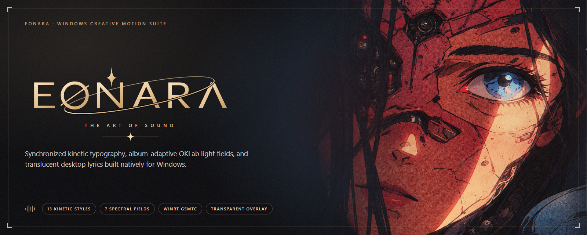
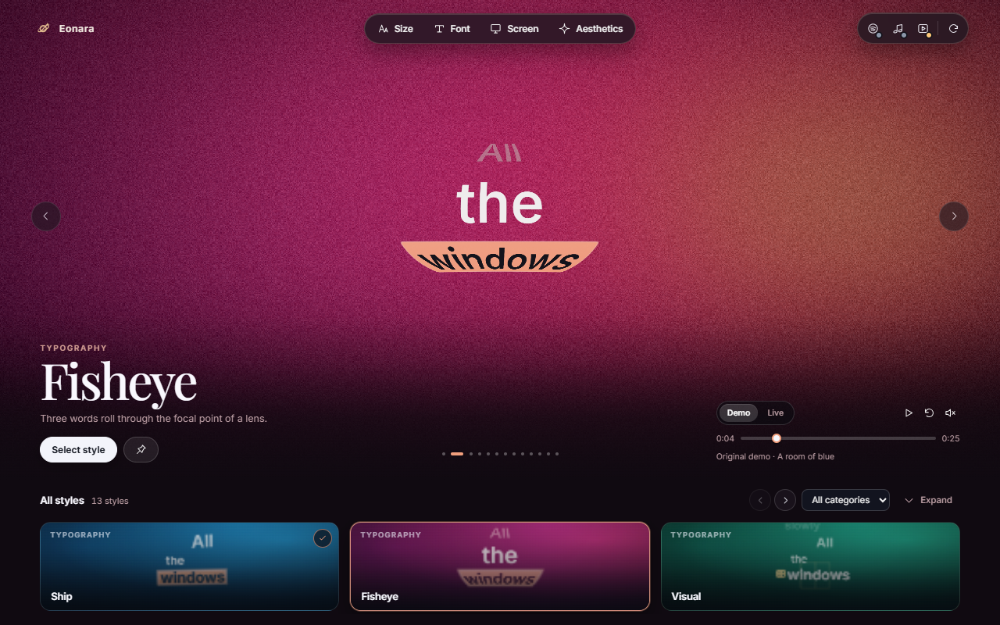
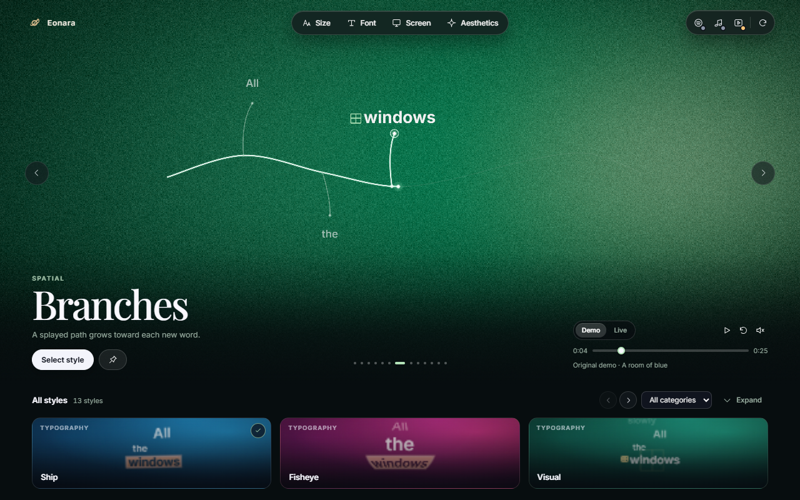
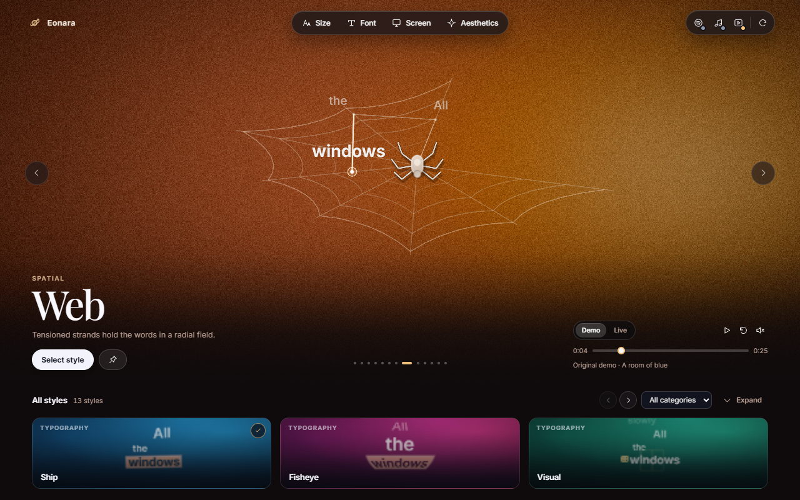
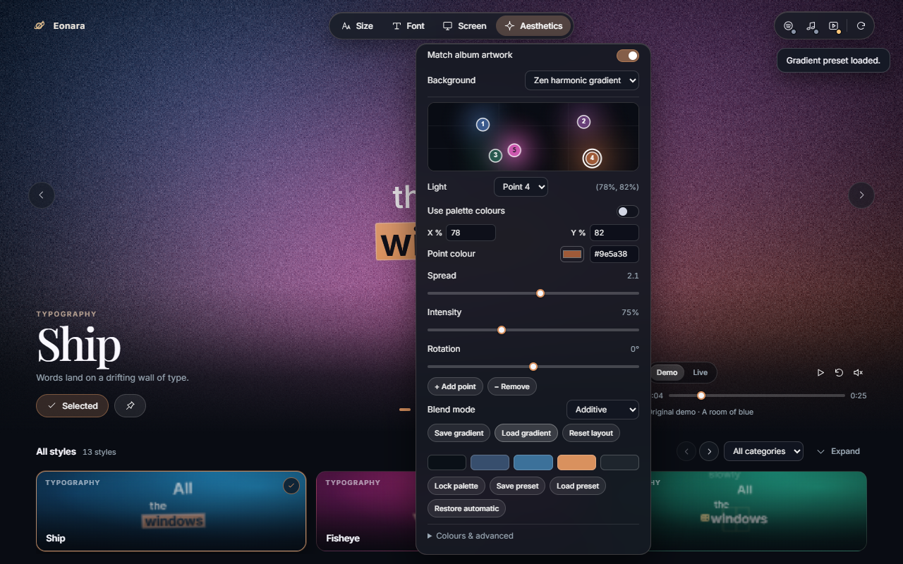
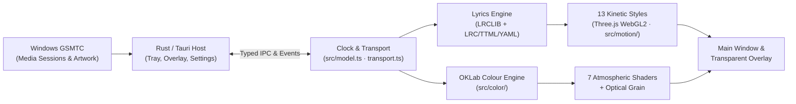

<p align="center">
  
</p>

<div align="center">
  <h1>Eonara</h1>
  <p><strong>The Art of Sound</strong> — Synchronized kinetic lyrics, album-adaptive OKLab shaders, optical grain, and a click-through Windows desktop overlay.</p>

  <p>
    
    
    
    
    
  </p>

  <p>
    <a href="#visual-showcase">Showcase</a> ·
    <a href="#highlights">Highlights</a> ·
    <a href="#architecture">Architecture</a> ·
    <a href="#run-the-demo">Quick Start</a> ·
    <a href="https://github.com/Demmonics/Eonara-Android">Eonara for Android</a>
  </p>
</div>

---

Eonara (formerly *LyricMotion*) is an independent Windows desktop application for synchronized lyrics, kinetic WebGL2 typography, and atmospheric colour fields driven organically by album artwork.

It includes **13 kinetic styles**, **7 spectral background modes**, a **Zen harmonic gradient editor**, an original audio-optional **Demo** (*A room of blue*), live **Windows GSMTC** media integration, and a configurable **click-through desktop overlay**.

---

## Visual Showcase

<p align="center">
  
  <br/>
  <em><strong>Ship</strong> — Staggered vertical word wall with measured focus emphasis, persistent accent history, perceptual colour grading, and calibrated silver-halide grain.</em>
</p>

<table>
  <tr>
    <td width="50%" align="center">
      <br/>
      <strong>Fisheye</strong> — Cylindrical optical lens warp with separated focal and rising slots
    </td>
    <td width="50%" align="center">
      <br/>
      <strong>Branches</strong> — Continuous cubic spline growth and collision-aware labels
    </td>
  </tr>
  <tr>
    <td width="50%" align="center">
      <br/>
      <strong>Web</strong> — Asymmetric radial filaments anchored around a central weaver hub
    </td>
    <td width="50%" align="center">
      <br/>
      <strong>Zen Harmonic Gradient</strong> — Multi-stop interactive light field &amp; preset editor
    </td>
  </tr>
</table>

---

## Highlights

- **13 Kinetic & Spatial Styles**: *Ship*, *Fisheye*, *Fisheye Visual*, *Visual*, *Codestyle*, *Codestyle Visual*, *Message Thread* (with procedural Map Attachment Cards), *Branches*, *Web*, *Constellation*, *Map Journey*, *Payments Ledger*, and *Notifications* — each with curated demo grading and deterministic choreography.
- **Album-Adaptive Perceptual Colour Engine**: Extracts OKLab/OKLCH palettes from live album thumbnails with silver-halide optical grain, atmospheric shader composition, and WCAG-verified glass materials across **7 background modes** (*Atmospheric*, *Liquid Glass*, *Blurred Album Artwork*, *Mesh Gradient*, *Zen Harmonic Gradient*, *Minimal*, and *Manual*).
- **Native Windows Host (`src-tauri/`)**: Follows active Windows media sessions (Spotify, Apple Music, browsers, and other GSMTC players), exposes a click-through desktop overlay with global recovery shortcut (**Ctrl+Alt+Shift+L**), and hides cleanly to the branded system tray.
- **Synchronized Lyrics & Local Import**: Optional privacy-preserving lookup via public **LRCLIB**, plus local `.lrc`, Enhanced LRC, `.ttml`, Lyricsfile YAML, and plain-text import with remembered per-track offset and honest timing-quality indicators.

---

## Architecture



Detailed module boundaries and verification records are documented in [Architecture](docs/ARCHITECTURE.md), [Color Engine](docs/COLOR_ENGINE.md), [Palette Protocol](docs/PALETTE_PROTOCOL.md), [Test Report](docs/TEST_REPORT.md), and [Benchmarks](docs/BENCHMARKS.md).

---

## Run the Demo

Requires Node.js 24+ and npm.

```powershell
npm.cmd ci
npm.cmd run dev
```

Open the local Vite loopback URL to explore all 13 styles, 7 background modes, Zen gradient editor, and original demo transport directly in your browser. Native media-session tracking, tray controls, and the translucent desktop overlay require the Windows build below.

---

## Build for Windows

Requires Windows 11 x64, WebView2 Evergreen Runtime, Rust MSVC toolchain, and Visual Studio C++ Build Tools + Windows 10/11 SDK.

```powershell
npm.cmd ci
npm.cmd test
npm.cmd run build
.\scripts\build-native.ps1 -Mode dev
```

To build the branded Windows executable and NSIS installer (`Eonara_0.3.0_x64-setup.exe`):

```powershell
$env:CARGO_BUILD_JOBS = '2'
.\scripts\build-native.ps1 -Mode release
```

Headless fixture and visual smoke checks run against a local preview (`vite preview --host 127.0.0.1 --port 1443 --strictPort`):

```powershell
python tests/visual_fixtures.py --url http://127.0.0.1:1443/ --styles all --out .playwright/fixtures/verify
python tests/browser_v03.py --url http://127.0.0.1:1443/ --out .playwright/fixtures/v03 --motion
```

---

## Companion Project

- **[Eonara for Android](https://github.com/Demmonics/Eonara-Android)** — Native Rust + direct `wgpu` + WGSL + `cosmic-text` Android companion implementing `NativeActivity` rendering and Kotlin/JNI MediaSession synchronization without a WebView.

---

## Upgrade & Storage Compatibility

To preserve seamless upgrades, settings, imported fonts, saved gradients, and cached lyrics for existing *LyricMotion* users:

- Windows package identifier remains `app.lyricmotion.desktop` (preserving `%APPDATA%\app.lyricmotion.desktop\settings-v1.json`).
- Existing `localStorage` and IndexedDB stores (`lyricmotion.settings.v1`, `lyricmotion.palette.*`, `lyricmotion.zenPreset`, `lyricmotion-local`) remain supported.
- Both `Eonara Imported *` and legacy `LyricMotion Imported *` custom fonts continue loading automatically.

---

## Privacy & Inspiration

- **Privacy**: Artwork and track snapshots come locally from Windows GSMTC. Optional LRCLIB lookups send only track metadata (title, artist, optional album/duration) — no account tokens, audio, or telemetry. No third-party lyrics database is bundled.
- **Inspiration**: Eonara is an independent project inspired by kinetic lyric design pioneers such as *Verci* and album-wide harmony concepts such as *LiquidMusic*, built from scratch with original Rust, TypeScript, and Three.js shaders. No third-party application binaries or proprietary assets are included.

---

## License

Dual-licensed under [MIT](LICENSE-MIT) OR [Apache-2.0](LICENSE-APACHE) (see [LICENSE](LICENSE)), with bundled fonts under SIL OFL 1.1. See [Third-Party Notices](docs/THIRD_PARTY_NOTICES.md).
