<div align="center">
  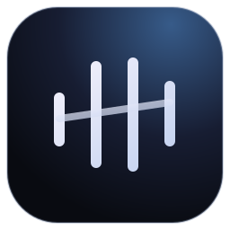
  <h1>LyricMotion</h1>
  <p><strong>Synchronized kinetic lyrics, album-adaptive OKLab shaders, and a click-through Windows desktop overlay.</strong></p>

  <p>
    
    
    
    
    
  </p>

  <p>
    <a href="#visual-showcase">Showcase</a> ·
    <a href="#feature-status-matrix">Feature Matrix</a> ·
    <a href="#architecture">Architecture</a> ·
    <a href="#quick-start">Quick Start</a> ·
    <a href="https://github.com/Demmonics/LyricMotion-Android">Android Companion</a>
  </p>
</div>

---

LyricMotion reads live playback metadata, timelines, and album artwork from Windows **Global System Media Transport Controls (GSMTC)**—with zero Spotify API credentials, browser injections, or Spicetify hooks—and renders real-time kinetic typography in both a studio workspace and a transparent click-through desktop overlay.

An original interactive demo (*A room of blue*) is built in so you can preview every motion style, colour engine mode, and shader preset immediately without a media player running.

---

## Visual Showcase

### Kinetic Typography & Motion Workspace

<div align="center">
  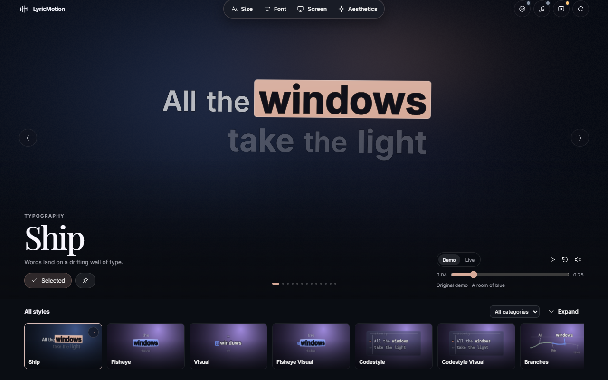
  <p><em><strong>Ship</strong> — Words land with damped vertical impulse onto an asymmetric 3D slab with persistent context history and 35 mm optical grain.</em></p>
</div>

<table>
  <tr>
    <td width="50%" align="center">
      <br/>
      <strong>Fisheye</strong> — Cylindrical radial vertex warp with separated focal &amp; rising slots
    </td>
    <td width="50%" align="center">
      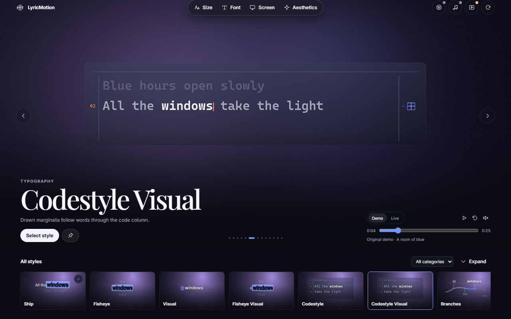<br/>
      <strong>Codestyle Visual</strong> — Grapheme-safe monospace reveal with live margin annotations
    </td>
  </tr>
  <tr>
    <td width="50%" align="center">
      <br/>
      <strong>Branches</strong> — Continuous cubic Catmull-Rom path connecting lyrical beats
    </td>
    <td width="50%" align="center">
      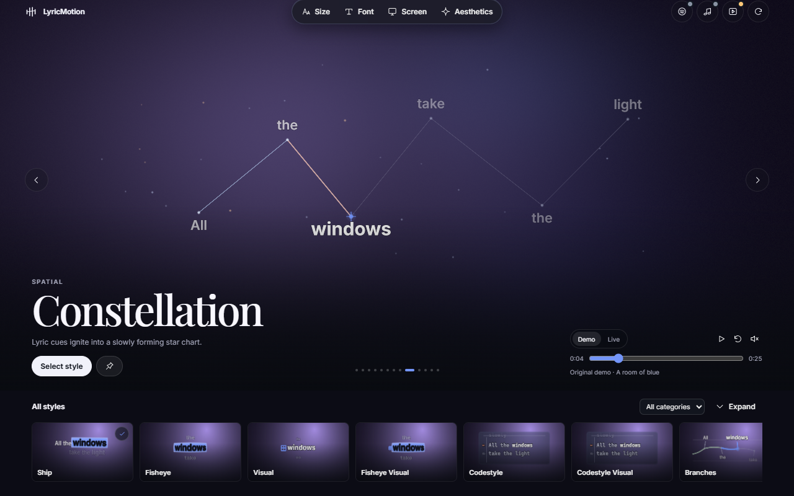<br/>
      <strong>Constellation</strong> — Stationary multi-cue star clusters that ignite sequentially
    </td>
  </tr>
  <tr>
    <td width="50%" align="center">
      <br/>
      <strong>Web</strong> — Asymmetric tensioned strands anchored around a sculptural central hub
    </td>
    <td width="50%" align="center">
      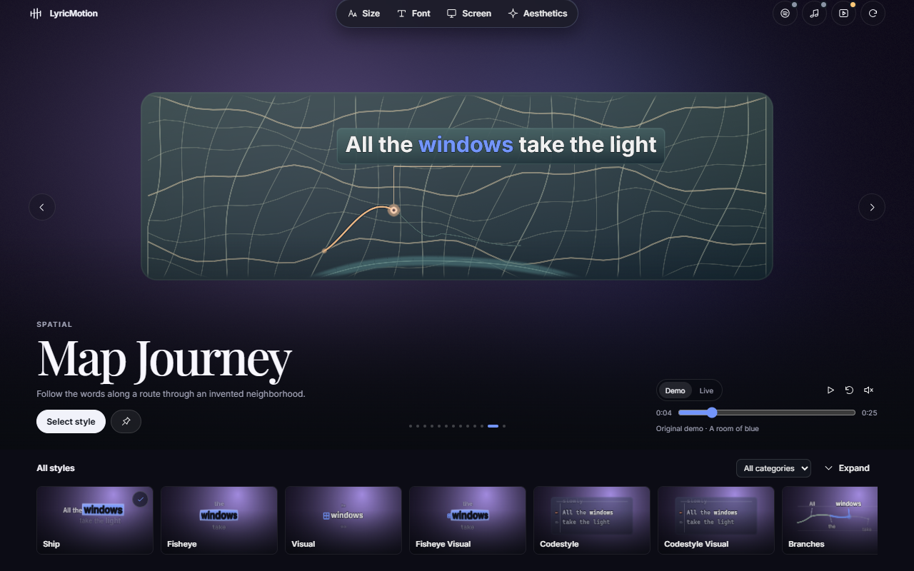<br/>
      <strong>Map Journey</strong> — Arc-length route tracking cues across an invented street grid
    </td>
  </tr>
  <tr>
    <td width="50%" align="center">
      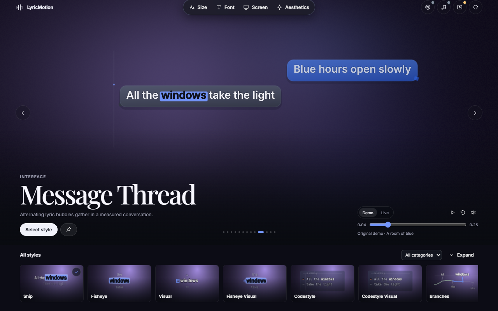<br/>
      <strong>Message Thread</strong> — Speaker-grouped conversational bubbles with word highlights
    </td>
    <td width="50%" align="center">
      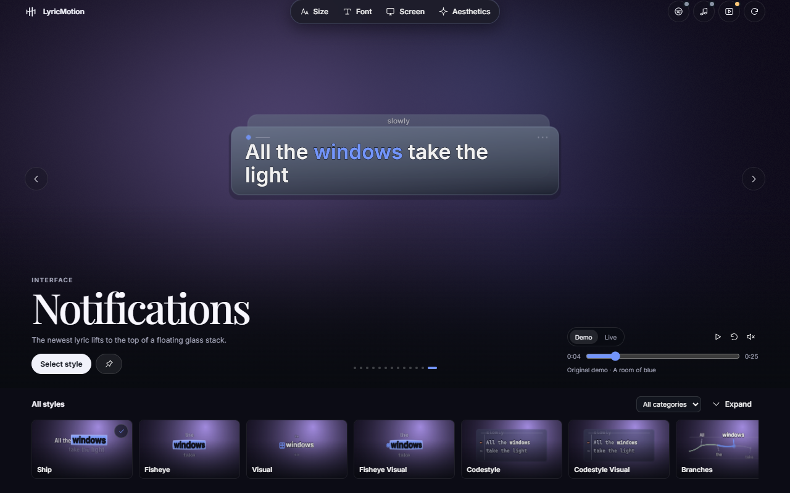<br/>
      <strong>Notifications</strong> — Depth-sorted frosted glass stack isolating the active phrase
    </td>
  </tr>
</table>

<div align="center">
  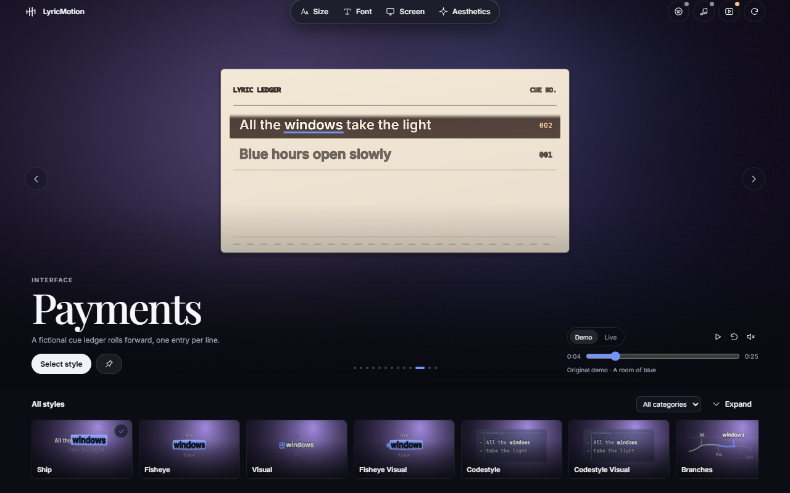
  <p><em><strong>Payments</strong> — Height-driven rolling ledger cards across all 13 styles (plus <strong>Visual</strong>, <strong>Fisheye Visual</strong>, and <strong>Codestyle</strong>).</em></p>
</div>

### Shaders, Zen Harmonic Editor & Desktop Overlay

<table>
  <tr>
    <td width="50%" align="center">
      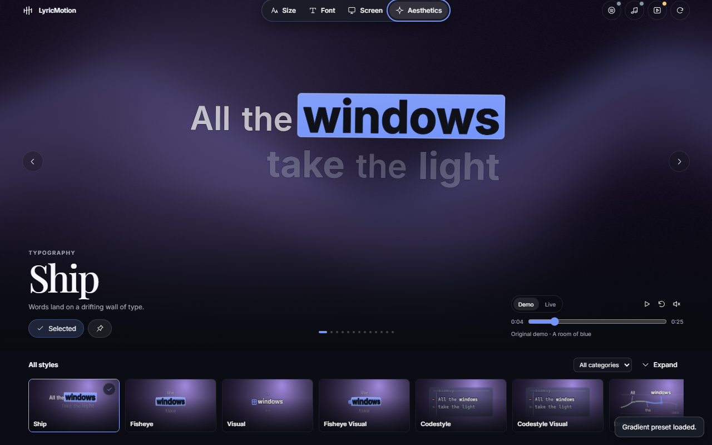<br/>
      <strong>Liquid Glass &amp; 6 Shader Modes</strong> — Artwork, Minimal, Atmospheric, Liquid Glass, Mesh, and Zen harmonic gradients driven by an off-thread OKLab/OKLCH palette extractor
    </td>
    <td width="50%" align="center">
      <br/>
      <strong>Zen Harmonic Editor</strong> — Interactive multi-point shader light canvas with per-point spread, intensity, rotation, additive/screen/soft-light blends, and JSON preset import/export
    </td>
  </tr>
  <tr>
    <td width="50%" align="center">
      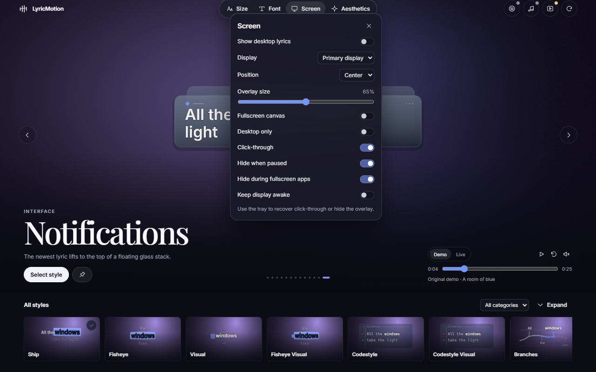<br/>
      <strong>Desktop Screen Controls</strong> — Multi-monitor selection, overlay scale/position presets, click-through toggle, pause auto-hide, fullscreen-app hiding, and wake lock options
    </td>
    <td width="50%" align="center">
      <br/>
      <strong>Transparent Windows Overlay</strong> — Click-through Win32 <code>WS_EX_TRANSPARENT</code> overlay (captured on an offline QA lyric fixture from the <code>refinement/native-motion</code> pass) with global panic toggle <code>Ctrl+Alt+Shift+L</code> and tray recovery
    </td>
  </tr>
</table>

---

## Feature Status Matrix

LyricMotion distinguishes strictly between features verified by automated tests / deterministic browser fixtures and areas actively under native refinement or awaiting broader hardware qualification:

| Area | Status | Notes & Evidence |
|---|---|---|
| **13 Kinetic Typography / Spatial / Interface Styles** | **Verified (Fixtures & Unit)** | Ship, Fisheye, Visual, Fisheye Visual, Codestyle, Codestyle Visual, Branches, Map Journey, Constellation, Web, Message Thread, Payments, Notifications (`npm.cmd test`: all unit specs; `tests/visual_fixtures.py` @ 760×530, 1280×800, 1920×1080) |
| **OKLab / OKLCH Album Colour Engine & 6 Shaders** | **Verified (Fixtures & Unit)** | Dedicated Web Worker median-cut / perceptual quantization, WCAG/OKLab contrast clamping, smooth crossfade transitions (`palette.test.ts`, `materials.test.ts`, `gradientState.test.ts`) |
| **Lyrics Parsers & LRCLIB Cache** | **Verified (Unit)** | Standard & Enhanced LRC, TTML (`<p>` & `<span>`), draft Lyricsfile YAML, plain text, explicit timing quality tags, backoff & IndexedDB cache (`parse.test.ts`, `lookup.test.ts`) |
| **Windows GSMTC Media Integration** | **Verified (Controlled & Spotify Spot-Check)** | Reads active Windows media session title, artist, album, position, playback rate, and thumbnail streams via `windows` WinRT bindings; paused-seek timeline correction validated on controlled SMTC fixtures (`spikes/qa/smtc_publisher.ps1`) |
| **Click-Through Overlay & Panic Shortcut** | **Verified (Win32 Oracle — `refinement/native-motion`)** | `WS_EX_TRANSPARENT` pass-through, blocking mode, tray reopen, and `Ctrl+Alt+Shift+L` escape hatch verified against an actual background Win32 message receiver |
| **Multi-Monitor / Mixed-DPI / Game Fullscreen** | **Needs Broader Qualification** | Single-display primary monitor validated (`1920×1080 @ 1.25×`); multi-monitor mixed-DPI and exclusive-fullscreen game interaction remain open for hardware testing |
| **Hidden-Window Render Suspension & Visual Polish** | **In Active Branches** | See [`refinement/native-motion`](../../tree/refinement/native-motion) (host visibility suspension & Message Thread overlap fix) and [`refinement/visual-identity`](../../tree/refinement/visual-identity) (35 mm film grain & glass contrast refinement) |

---

## Architecture

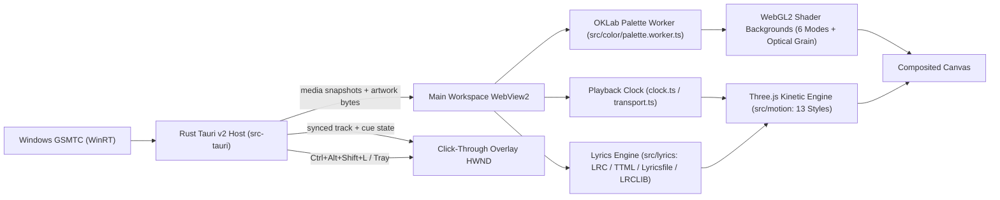

### Engineering Highlights

- **Zero External Account Coupling**: Uses native Windows GSMTC sessions directly—works with Spotify desktop, Apple Music, browser media tabs, and local players exposing SMTC without API keys or third-party client patches.
- **Deterministic Palette Worker**: Album artwork downsampling and OKLab clustering run inside an isolated Web Worker (`src/color/palette.worker.ts`), keeping UI frames smooth while discarding stale track-generation updates automatically.
- **Safe Desktop Overlay Design**: Overlay windows expose explicit tray recovery (**Show / Hide Overlay**, **Disable Click-Through**) plus the global `Ctrl+Alt+Shift+L` hotkey so desktop mouse focus can never get trapped.
- **Honest Timing Quality**: Every loaded lyric sheet surfaces its true timing fidelity (**Word-level**, **Line-level**, **Estimated words**, **Unsynchronized**, or **Unavailable**) alongside a per-track early/late millisecond offset dial (`±1 s` / `±100 ms`).
- **Privacy by Default**: LRCLIB lookups contact only `https://lrclib.net/api/get` with basic track metadata when **Look up lyrics with LRCLIB** is enabled and can be disabled anytime in favor of local `.lrc` / `.ttml` / `.yaml` files.

---

## Quick Start

### 1. Run the Browser Demo Preview (Fastest)

Explore all 13 kinetic styles, 6 background modes, and the Zen harmonic editor in any WebGL2 browser using **Node.js 24+**:

```powershell
npm.cmd ci
npm.cmd run dev
```

Open the local Vite URL printed in the terminal (`http://127.0.0.1:1420`) and press **Play** on the built-in **Demo** transport. *(Browser mode showcases the full typography and shader engine; Windows GSMTC sessions, tray controls, and the desktop overlay require the native Tauri build.)*

### 2. Run Automated Tests & Production Frontend Check

```powershell
npm.cmd test
npm.cmd run build
```

### 3. Build the Native Windows App & NSIS Installer

**Prerequisites (Windows 11 x64)**:
- **Node.js 24+** and **npm**
- **Rust stable (`x86_64-pc-windows-msvc`)**
- **Microsoft Edge WebView2 Evergreen Runtime** (pre-installed on Windows 11)
- **Visual Studio C++ Build Tools** with a **Windows 10/11 SDK**

From a PowerShell terminal in the repository root:

```powershell
npm.cmd ci
.\scriptsuild-native.ps1 -Mode dev
```

To build the release executable (`target/release/lyricmotion.exe`) and NSIS installer (`target/release/bundle/nsis/LyricMotion_*_x64-setup.exe`):

```powershell
.\scriptsuild-native.ps1 -Mode release
```

> **Linker Note**: [`scripts/build-native.ps1`](scripts/build-native.ps1) automatically discovers Visual Studio Build Tools and Windows SDK CRT libraries via `vswhere.exe` when `link.exe` is not already on `PATH`, configuring `rust-lld` process-locally without altering global environment variables.

---

## Active Development Branches

To keep `main` clean on the verified `v0.3.0-migrated` baseline while preserving parallel work cleanly, active follow-up refinements live on dedicated branches:

- [`refinement/native-motion`](../../tree/refinement/native-motion) — Host-reported native window visibility suspension (eliminating WebGL draws when closed to tray or minimized), Message Thread rotated-entry spacing fix, real-receiver Win32 overlay input oracle, and native session telemetry harnesses.
- [`refinement/visual-identity`](../../tree/refinement/visual-identity) — 35 mm perceptual film grain calibration, deeper colour grading across glass surfaces, and Zen gradient editor UX polish *(latest lightweight WIP commit pending final re-test)*.

---

## Companion Project

- 📱 **[LyricMotion-Android](https://github.com/Demmonics/LyricMotion-Android)** — Native Rust + direct `wgpu` + WGSL + `cosmic-text` Android companion implementing `NativeActivity` rendering and Kotlin/JNI MediaSession synchronization without a WebView.

---

## Documentation Index

- [`docs/ARCHITECTURE.md`](docs/ARCHITECTURE.md) — Module boundaries, clocks, workers, and IPC design
- [`docs/COLOR_ENGINE.md`](docs/COLOR_ENGINE.md) — OKLab extraction, luminance contrast guards, and shader uniforms
- [`docs/PALETTE_PROTOCOL.md`](docs/PALETTE_PROTOCOL.md) — Track-generation palette message protocol
- [`docs/TEST_REPORT.md`](docs/TEST_REPORT.md) — Reproducible native oracle, SMTC fixture, and browser fixture guides
- [`docs/BENCHMARKS.md`](docs/BENCHMARKS.md) — CPU, memory, and GPU profiling methodology
- [`THIRD_PARTY_NOTICES.md`](THIRD_PARTY_NOTICES.md) & [`SECURITY.md`](SECURITY.md) — Licensing, bundled OFL fonts, and privacy scope

---

## Inspiration, License & Credits

- **License**: Dual-licensed under [`MIT`](LICENSE-MIT) OR [`Apache-2.0`](LICENSE-APACHE) (see [`LICENSE`](LICENSE)).
- **Inspiration**: Kinetic typography concepts are visually inspired by **Verci**; album-wide colour harmony draws conceptual inspiration from **LiquidMusic**. All Three.js scenes, GLSL shaders, Rust host integrations, and typography layouts in this repository are original implementations with no proprietary code or media redistributed.
- **Transparency**: Built through iterative engineering and AI-assisted development (Codex and Antigravity), verified locally against unit tests, offscreen visual fixtures, and Windows native QA harnesses.
