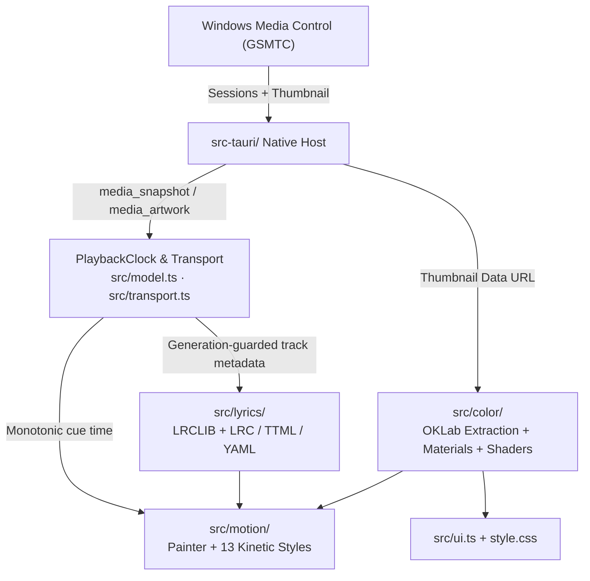

# Eonara Architecture

Eonara renders two synchronized WebGL2 surfaces from one shared TypeScript/Three.js engine:

- **Main Workspace Window**: Full atmospheric shader pass, silver-halide optical grain, kinetic typography pass, gallery thumbnails, and frosted-glass UI controls.
- **Transparent Desktop Overlay**: Always-on-top click-through typography surface with optional localized backdrop scrim and global **Ctrl+Alt+Shift+L** recovery shortcut.

## Module Responsibilities

| Path | Responsibility |
|---|---|
| `src-tauri/` | WinRT GSMTC session monitoring & thumbnail streams, Tauri window lifecycle, branded system tray, global shortcut recovery, atomic `settings-v1.json` persistence |
| `src/model.ts`, `src/main.ts` | Monotonic playback clock anchoring, active player selection, async generation cancellation, Demo/Live mode switching, Splash & About UI wiring |
| `src/lyrics/` | Independent LRC, Enhanced LRC, TTML, and Lyricsfile YAML parsers, matching rules, bounded LRCLIB lookup, and opt-in timing estimation |
| `src/motion/` | Deterministic 3D typography geometry (`Painter`, `TextAtlas`, `choreography.ts`, `heroGeometry.ts`) and 13 kinetic/spatial styles |
| `src/color/` | Web Worker OKLab/OKLCH artwork quantization, curated per-style demo grades, contrast-bounded glass materials (`materials.ts`), and atmospheric GPU background passes |
| `src/ui.ts`, `src/style.css` | Hero stage chrome, style gallery, Zen harmonic gradient editor, Splash entrance, and About Eonara modal |
| `src/storage.ts` | Local IndexedDB font and user-imported lyrics persistence (`lyricmotion-local` preserved for upgrade continuity) |
| `assets/brand/`, `public/brand/` | Official Eonara SVG marks, wordmarks, hero artwork, icons, and NSIS branding derived from `logo-eonara.png` |
| `tests/`, `spikes/qa/` | Vitest unit suites, Playwright headless visual fixture runners, colour/grain audits, and Win32 overlay oracles |

## Upgrade & Invariant Design

- **Identifier continuity**: Tauri `identifier` remains `app.lyricmotion.desktop` so existing user settings (`settings-v1.json`), WebView2 origin storage, IndexedDB imported fonts/lyrics, and `localStorage` caches carry forward cleanly across upgrades.
- **Timeline isolation**: Artwork decoding, palette interpolation, and style switches never mutate transport playback clocks. Superseded async lyric lookups and thumbnail decodes are discarded via generation counters.
- **No external runtime dependencies**: All fonts, icons, shaders, and UI assets are bundled locally; only user-enabled LRCLIB lookups contact `https://lrclib.net`.
